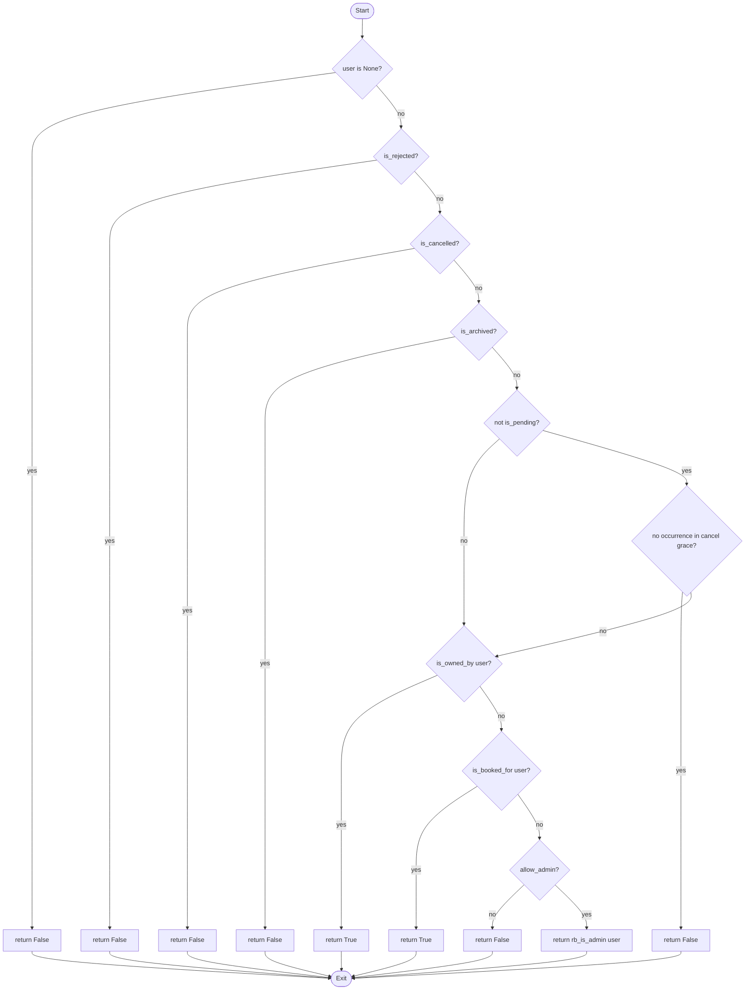

# Static analysis and cyclomatic complexity

## Scan details

| Field | Value |
|---|---|
| SonarQube version | Pending scan |
| Scan date | Pending scan |
| Commit | Pending scan |
| Analyzed production scope | `indico/modules/rb` |
| Analyzed test scope | `tests/team/unit`, `tests/team/api` |
| Raw evidence | Save under `docs/team/evidence/area1/` after scan |

## Metrics

Fill the values from the actual SonarQube scan. Do not estimate or type values from memory.

| Metric | Value | What it tells us about quality/risk | Action / risk link |
|---|---:|---|---|
| Cyclomatic complexity | Pending scan | Number of independent code paths; high values need more careful tests and are harder to maintain | |
| Cognitive complexity | Pending scan | How difficult the code is to follow, especially with nested logic | |
| Duplications | Pending scan | Repeated code that may need coordinated fixes | |
| Code smells | Pending scan | Maintainability issues | |
| Bugs | Pending scan | Reliability issues identified by SonarQube | |
| Vulnerabilities / security hotspots | Pending scan | Potential security weaknesses requiring review | |
| Coverage | Pending scan | Portion of analyzed code reached by tests; distinguish the Room Booking rule surface from the module-wide number | |
| Technical debt | Pending scan | Estimated effort to fix maintainability issues | |
| Ratings | Pending scan | SonarQube's reliability, security, and maintainability assessment | |

## Hand-calculated cyclomatic complexity

Function: `Reservation.can_cancel` (`indico/modules/rb/models/reservations.py`, around line 451 in the frozen source).

The control-flow graph below splits short-circuit Boolean checks into separate decision nodes and joins all return paths at one exit. It has `N = 20` nodes, `E = 28` edges, and one connected component (`P = 1`).

| Nodes N | Edges E | Components P | Calculation `E − N + 2P` | Decision count + 1 | Sonar value |
|---:|---:|---:|---:|---:|---:|
| 20 | 28 | 1 | `28 − 20 + 2 = 10` | `9 + 1 = 10` | Pending scan |

The nine control-flow decision nodes come from the initial `user is None` check, the three checks in the rejected/cancelled/archived expression, the pending/grace-period expression, the owner/booked-for expression, and the final admin checks. Confirm this count against the SonarQube value after scanning; if it differs, inspect Sonar's Python counting rules and the exact analyzed function.

## Evidence screenshots to capture

After SonarQube is running and the scan completes, save these screenshots (plus the raw scan/report export if available) under `docs/team/evidence/area1/`:

1. **Project Overview:** project name, scan time, and overall quality-gate status.
2. **Measures / Complexity:** overall complexity and the `Reservation.can_cancel` function-level complexity.
3. **Measures / Duplications and Coverage:** duplication and coverage values, with the analyzed scope visible if possible.
4. **Issues:** counts/categories for code smells, bugs, vulnerabilities, and security hotspots.
5. **Maintainability:** technical debt and ratings.

Use descriptive names such as `sonar-overview.png`, `sonar-complexity-can-cancel.png`, and `sonar-issues.png`. Screenshots supplement the report; they do not replace actual metrics or raw tool output.
